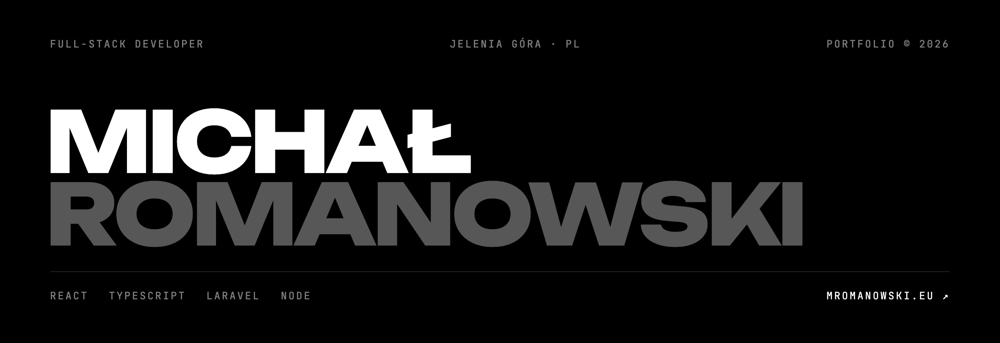

 

Full-stack developer from Poland. I build web apps end to end with **React + TypeScript** on the front and **Laravel** on the back.

By day I work at **Synteco**. After hours I co-run **[kodify.pl](https://kodify.pl)**, a small studio shipping websites and apps for real clients, and build my own products under **Nyx**.

[mromanowski.eu](https://mromanowski.eu) · [LinkedIn](https://www.linkedin.com/in/dewik33/) · [kontakt@mromanowski.eu](mailto:kontakt@mromanowski.eu)

 

### Stack I use every day

      

      

### Also shipped with

          

 

### Selected work

- **[Covalio](https://mromanowski.eu)** · Workspace SaaS for software houses: tasks, real-time chat, time tracking, wiki, client portal and an encrypted vault. Multi-tenant. `Laravel` `React Router` `Reverb`
- **[NyxStudio](https://nyxstudio.pl)** · In-browser graphics tools for Minecraft creators with a paid marketplace and a creator programme. `React` `Hono` `Drizzle` `Stripe`
- **[Kodify Builder](https://mromanowski.eu)** · Website builder for local businesses: drag & drop editor, industry templates, AI content, custom domains. `Laravel` `React` `Puck`
- **[NyxHost](https://mromanowski.eu)** · Discord bot hosting: every bot in its own Docker container, live console, file manager, payments. `Next.js` `Prisma` `Docker`
- **Nyx plugins** · 50+ plugins and minigames for a Minecraft network, built on a shared core. `Java` `Paper API`

Most of this lives in private repos. Case studies are on **[mromanowski.eu](https://mromanowski.eu)**, and I'm happy to walk through the code in an interview.
